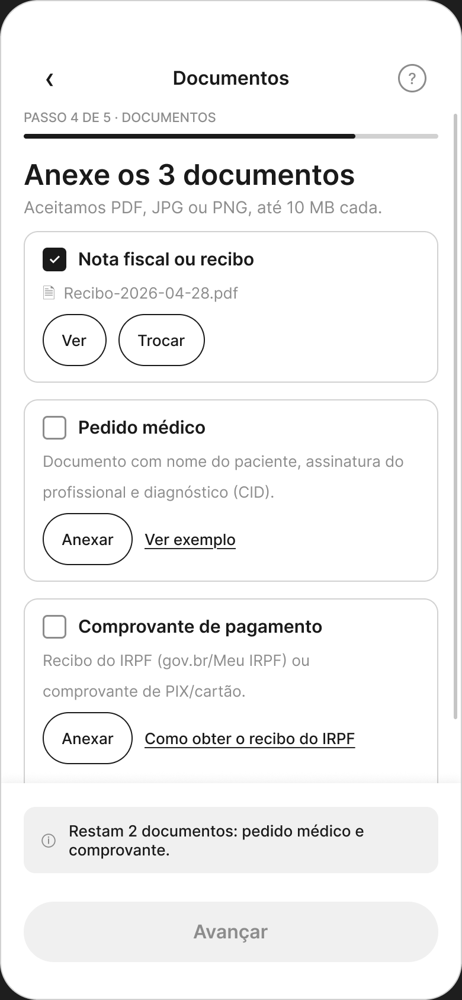
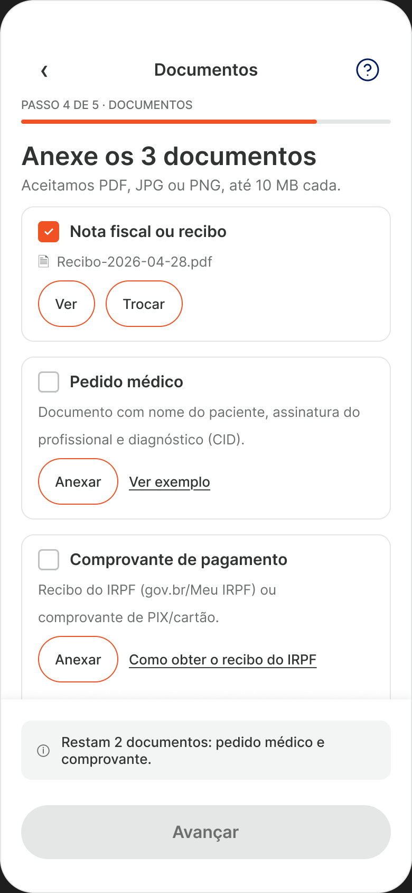

# Ninguém decora o próprio CRP

**Redesign do fluxo de reembolso do app SulAmérica**
Estudo de caso UX/UI · do problema observado ao protótipo navegável

---

Uma pessoa próxima faz terapia toda semana. Todo mês ela precisa pedir reembolso das
quatro sessões pelo app do plano de saúde, e todo mês ela reclama da mesma coisa. Um
dia eu sentei do lado dela para ver.

Levou onze minutos. Teve uma saída do app para outro site do governo, teve um campo
pedindo o número de registro profissional da psicóloga, e teve um erro de data que só
apareceu quando tudo já estava preenchido.

Esse case é o que eu fiz com aqueles onze minutos.

**O que tem aqui:** 32 capturas do fluxo real, uma avaliação heurística completa, um
fluxo novo, 44 telas desenhadas, um design system reconstruído por medição e um
protótipo clicável de 43 telas.

[Ver o arquivo no Figma →](https://www.figma.com/design/LUp4aT7fVYH4cD8ZwrHIfd/Reembolso-SulAmerica)

---

# 1 · Diagnóstico

## Comecei olhando, não lendo

Não houve briefing. Houve uma pessoa real, um aparelho na mão dela e eu ao lado
perguntando "o que você acha que vai acontecer agora?".

Acompanhei ela pedir reembolso **mais de uma vez**, e isso mudou o que eu vi. Na
primeira vez tudo parece novidade e a pessoa perdoa a fricção. Na terceira, ela já
sabe onde vai travar, e começa a se preparar: junta os documentos antes, deixa o
recibo aberto em outra aba, respira fundo no campo que ela sempre erra. **Essa
antecipação é sintoma.** Um fluxo que obriga o usuário a se preparar para usá-lo está
transferindo trabalho que era do produto.

Ela me deu as 32 capturas que sustentam este case inteiro, tiradas durante os
próprios pedidos. Depois, com os wireframes prontos, mostrei as soluções para ela
dizer o que fazia sentido.

> **Sobre o tamanho disso.** É pesquisa qualitativa com um participante: observação
> repetida, conversa e devolutiva sobre a proposta. Um participante mostra bem **onde**
> dói e mal **quanto** dói. Por isso todo número de impacto neste case está marcado
> como hipótese, e por isso a primeira coisa na minha lista de próximos passos é levar
> isso para mais gente.

## Transformei "acho que tá ruim" em diagnóstico

Impressão não convence ninguém, então passei as 32 telas pelas 10 heurísticas de
Nielsen, dando nota, listando cada problema com a tela onde ele aparece e
classificando a severidade.

**Média 4,1 de 10. Duas heurísticas em severidade crítica, seis em alta.**

| Heurística | Nota | Severidade |
|---|---|---|
| 5 · Prevenção de erros | 3/10 | **Crítica** |
| 9 · Recuperação de erros | 3/10 | **Crítica** |
| 10 · Ajuda e documentação | 3/10 | Alta |
| 1 · Visibilidade do status | 4/10 | Alta |
| 3 · Controle e liberdade | 4/10 | Alta |
| 6 · Reconhecimento vs. memorização | 4/10 | Alta |
| 7 · Flexibilidade e eficiência | 4/10 | Alta |
| 2 · Sistema × mundo real | 5/10 | Alta |
| 8 · Estética e minimalismo | 5/10 | Média |
| 4 · Consistência e padrões | 6/10 | Média |

As duas notas críticas caíram no mesmo lugar: **erro**. O app previne mal e socorre
pior. E isso não é coincidência, é o retrato de um fluxo desenhado para o caso em que
tudo dá certo.

## As três telas que decidiram o projeto

**O erro que chega tarde demais.**

A pessoa digita quatro datas. Na terceira, escreve 19/06/2026, uma data que ainda não
aconteceu. O app responde: *"O pedido só pode ser feito para procedimentos realizados
antes do dia 04/05/2026."*

Leia de novo devagar, porque eu li três vezes. A mensagem dá um limite, não explica a
regra. Ela não diz "essa data ainda não chegou". Quem está no meio do preenchimento
precisa fazer aritmética de calendário para entender o que o app quis dizer, e o botão
*Próximo* fica cinza e calado enquanto isso.

**O campo que ninguém consegue preencher.**
Em outra tela, o app pede o CRP do prestador. Eu marco psicóloga toda semana há um ano
e não sei o CRP dela de cabeça. Ninguém sabe. Esse número está, no melhor dos casos,
impresso em algum recibo guardado numa pasta de downloads.

Pedir um dado que o usuário não tem não é um problema de campo mal desenhado. É o
produto descobrindo, tarde, que precisava de uma informação e empurrando a busca para
quem menos tem condição de fazê-la. **O dado está na nota fiscal que o próprio app vai
pedir três telas depois.**

**A saída do app no meio do caminho.**
Para anexar o comprovante de pagamento, a pessoa precisa sair do SulAmérica, abrir o
gov.br, fazer login, baixar um PDF e voltar. Nenhuma tela é feia. O problema é que o
fluxo tem uma porta para fora bem no meio, e do outro lado dela tem um login federal.

## O que eu entendi, e que mudou o projeto

Minha primeira hipótese era que o culpado fosse o compliance: o termo jurídico, a
validação de identidade, a lista de documentos obrigatórios. É o palpite fácil.

O mapeamento me mostrou outra coisa. As etapas obrigatórias são **cinco**, de dezoito.
O peso não vinha delas, vinha de **onde** elas estavam e de **quantas vezes** se
repetiam. A validação biométrica acontecia no fim, quando desistir já custa caro. O
termo reaparecia a cada pedido. Os dados bancários eram redigitados todo mês, mesmo
já estando no cadastro do plano.

> **A restrição não era o inimigo. A ordem era.**

Essa frase virou o princípio do redesign inteiro, e é o que separa este projeto de
"deixar mais bonito".

---

# 2 · O novo fluxo

## Cinco princípios, e um filtro para cada decisão

Antes de desenhar qualquer coisa, escrevi cinco princípios, cada um amarrado às
heurísticas que ele corrige. Eles funcionaram como filtro: toda vez que eu tinha duas
opções, a pergunta era qual delas serve ao princípio.

1. **OCR e reuso substituem digitação** sempre que o dado já existe em algum lugar.
2. **Stepper persistente**, porque ninguém deveria se perguntar quanto falta.
3. **Validação no momento da digitação**, com mensagem que diz o que fazer.
4. **Linguagem cidadã**, com ajuda ao lado do termo difícil e não num FAQ distante.
5. **Modo recorrente**, porque pedir pela quarta vez não pode pesar como a primeira.

## A decisão principal: tirar o peso do que se repete

O fluxo atual trata todo pedido como se fosse o primeiro. Minha proposta separa o que
acontece **uma vez** do que acontece **todo mês**.

**No onboarding, feito só no primeiro acesso:** confirmação dos dados bancários (que
já vêm do cadastro do plano, então é conferir e não digitar), o termo de ciência, e a
validação de identidade.

**No fluxo mensal:** cinco etapas, e nenhuma delas repete o que já foi resolvido.

Nenhuma exigência legal saiu. Todas continuam lá, cumpridas uma vez em vez de quatro
vezes por ano.

### A biometria mudou de lugar, e isso valeu por muitas telas

Hoje a validação de identidade acontece no **fim**, depois de todo o preenchimento.
Se ela falhar, a pessoa perde tudo que fez. Movi para o onboarding e aproveitei o
Face ID que ela já usou para abrir o app.

Um detalhe que eu quase deixei passar: a tela diz, em texto fixo, *"Vamos usar o Face
ID do seu iPhone"*. Se o aparelho não tiver biometria, o app afirma uma mentira na
primeira frase. Então **a checagem do aparelho acontece antes da tela renderizar**, e
quem não tem biometria cai direto na captura de selfie, com explicação própria.

Essa versão ganhou uma linha que a outra não precisa: *"A foto não vai para o seu
perfil."* Tirar uma selfie é o passo mais invasivo de todo o onboarding, e quem cai
nele é quem não teve escolha.

### O CRP resolveu-se sozinho

Assim que o OCR lê a nota fiscal, o CRP, o CPF, o nome do prestador, o valor e a data
aparecem preenchidos. O campo que era impossível virou um campo de conferência.

A tela seguinte mostra os seis campos lidos e diz: *"Lemos sua nota, confira. Toque em
qualquer campo para corrigir."* Não escondo o OCR atrás de mágica. Mostro o que foi
lido, porque OCR erra, e a correção precisa custar um toque.

### O gov.br entrou para dentro

Em vez da porta para fora, um tutorial em bottom sheet com os três passos, aberto
sobre a tela de documentos. A pessoa não perde o lugar onde estava.

## O que o novo fluxo mudou

| | Fluxo atual | Novo fluxo |
|---|---|---|
| Etapas com digitação ativa | ~12 | **5** (+1 onboarding único) |
| Telas até o envio | 30+ | ~10 |
| Digitar CRP, CPF e valor | sim | **não**, OCR |
| Saber quanto falta | não | stepper em toda tela |
| Quando o erro aparece | no fim | na digitação |
| Atalho para quem já usou | não | *Refazer última* e *Adicionar mais uma sessão* |
| Modais em cima do fluxo | 3 | **0** |
| Sair do app no meio | sim | não |
| Biometria | no fim | no onboarding, via Face ID |
| Etapas de compliance | 5 | **5**, reorganizadas |

A última linha é a que eu mais gosto. **Nenhuma exigência foi removida.**

---

# 3 · Wireframes, design system e interface

## Baixa fidelidade primeiro, e sem cor de propósito

Levei o fluxo inteiro para o Figma: **44 telas em escala de cinza**.

Cor atrapalha nesta fase. O que precisa ser julgado aqui é a ordem das perguntas, a
hierarquia e o texto, e cor vira argumento de gosto que rouba a conversa. Sem cor,
quando alguém diz "não entendi essa tela", o problema é mesmo a tela.

Três decisões de estrutura que tomei aqui e mantive até o fim:

**O frame é a viewport.** Todas as telas têm a altura exata do aparelho. Tela cujo
conteúdo passa disso **não cresce, ela corta**. Frame alto demais é confortável e
mente: mostra de uma vez o que o usuário só veria rolando, e faz sumir o problema de
hierarquia que existe na vida real.

**Um alvo por ação, com 44pt no mínimo.** O card é rótulo; quem é tocável é o botão
dentro dele. Isso nasceu de um erro meu: eu tinha feito o card de reembolso da home
como um bloco único clicável, com o título prometendo uma coisa e o texto abaixo
prometendo outra, para o mesmo toque.

**Cada estado é uma tela.** Vazio, preenchido, erro, carregando, primeiro acesso.

### O caminho feliz é confortável e desonesto

Em algum momento eu tinha 24 telas prontas e percebi que **todas mostravam o que
acontece quando dá certo**.

Isso era especialmente ruim neste projeto, onde as duas notas críticas da avaliação
eram justamente sobre erro. Sem uma tela de erro desenhada, a promessa de "validação
inline com mensagem prescritiva" fica sendo uma linha bonita num documento.

Desenhei três: a data fora do prazo, os campos do OCR com erro e com baixa confiança,
e a solicitação parada por falta de documento. **A terceira fechou um fio solto que eu
não tinha visto:** a tela de histórico já tinha um card *"Aguardando documento ·
Resolver agora →"* apontando para uma tela que não existia em lugar nenhum.

O mesmo raciocínio me fez desenhar o **primeiro acesso**. Eu tinha desenhado o app
todo para quem já tem histórico: a home dizia "você tem 1 solicitação em análise" e a
lista de categorias abria com "Suas mais usadas". Nada disso existe para quem nunca
pediu reembolso, que é justamente quem tem mais dificuldade.

## Aí eu fui atrás do design system

Com as telas de pé, precisava de cor. E aqui o projeto virou.

Eu ia fazer o que se faz: abrir as capturas, tirar os hex no conta-gotas, anotar
"laranja da marca" e seguir. Em vez disso fiz duas coisas.

Primeiro, **fui ler o CSS público do site da SulAmérica**, que expõe o design system
da empresa: 149 variáveis de cor, rampas completas e a família tipográfica declarada.

Segundo, **medi as capturas em vez de olhar para elas**. Escrevi scripts que contam
pixels: frequência de cada cor, altura de caixa alta para deduzir o corpo do texto,
perfil da curva dos cantos para achar o raio, contraste de cada par de texto e fundo.

Isso me deu duas fontes verificáveis para comparar, em vez de uma opinião minha.

### O achado que mudou meu diagnóstico

**O app não segue o sistema da própria empresa.**

| Onde | O app usa | A SulAmérica publica |
|---|---|---|
| Laranja da marca | `#FF5000` | `#F05223` |
| Verde de sucesso | `#1F662E` **e** `#00861F` | `#04843F` |
| Superfície secundária | cinco cinzas diferentes | um token |
| Título de tela | três tamanhos, de 13 a 21pt | um papel |

Eu esperava encontrar um app sem sistema. Encontrei **um sistema que o app não segue**,
e esses são problemas diferentes: o primeiro pede construção, o segundo pede
governança e migração.

Um padrão se repete em tudo: **um papel, várias respostas**. Nenhuma dessas variações
carrega significado. Cada uma custa uma decisão que alguém do time refaz toda vez.

### Uma falha de acessibilidade, com número

O botão desabilitado preenche com `#D2D2D2` e escreve em branco por cima. **Contraste
de 1,51:1.** O rótulo é ilegível, então quem chega num botão bloqueado não consegue ler
o que ele faria se estivesse ativo.

E a causa não é descuido. O sistema publicado tem token de *texto* desabilitado e
**nenhum de superfície** desabilitada. O app precisou de um e inventou. Achar a
lacuna na origem é mais útil que apontar o erro na tela.

### Duas coisas que o olho não pega

O app escurece o fundo atrás de modal de **dois jeitos**: preto a 40% em quatro telas e
a 30% em duas. Ninguém percebe isso olhando. Eu só achei porque dois cinzas específicos
são exatamente branco sob esses dois véus. Se eu tivesse anotado os dois como "cinza",
o sistema nasceria com dois tokens falsos.

A tipografia teve história parecida. Identifiquei a família comparando **sobreposição
de forma** entre a palavra renderizada em dez candidatas e o recorte real da captura.
A vencedora ganhou por 21 pontos, o que é um argumento; "parece Figtree" não é.

### A regra que organiza o sistema inteiro

Toda afirmação do design system carrega uma marca:

| Marca | Significa |
|---|---|
| **[declarado]** | a SulAmérica publica esse valor |
| **[medido]** | o app entrega esse valor |
| **[decidido]** | é escolha minha, e o documento diz por quê |

**A marca vale mais que o número.** Um sistema onde todo valor diz de onde veio pode
ser contestado item a item. Um sistema sem isso só pode ser aceito ou rejeitado
inteiro.

Foi a convenção que sobreviveu a tudo, e ela nasceu de um hábito de trabalho: conduzi
o projeto usando IA como par, e a única regra era **nada entra sem verificação**. Um
valor que não pode receber nenhuma das três marcas não entra no documento. Os scripts
ficaram no repositório para qualquer pessoa refazer as contas.

## Os mockups, sem perder os wireframes

Com o sistema pronto, apliquei a biblioteca nas 44 telas: 2.564 preenchimentos ligados
a variável, zero valor solto, 148 ícones desenhados.

**Os wireframes continuaram intactos numa página própria**, com os mesmos nomes de
arquivo dos mockups. Isso permite abrir a mesma tela lado a lado e ver o que a cor
mudou e o que ela não mudou.

| Wireframe | Mockup |
|---|---|
|  |  |

A estrutura é a mesma. Se ela só funciona colorida, ela não funciona.

---

# 4 · O protótipo, e o que ele cobrou

## Onde o arquivo parou de ser desenho

Até aqui eu tinha 44 telas bonitas e um sistema bem documentado. Liguei tudo num
protótipo navegável, comecei a clicar, e o arquivo começou a mentir.

Esta é a parte do case que eu mais quero que você leia, porque nenhum dos problemas
abaixo aparece olhando. Todos aparecem clicando.

## Protótipo não digita

O toque num campo precisa levar a uma versão **já preenchida** da tela. Então todo
formulário precisa existir nos dois estados. Essa regra sozinha criou seis telas que
não estavam previstas em lugar nenhum.

## Cinco defeitos que só o dedo encontrou

**1. O botão travado respondia ao toque.**
No termo de ciência, o botão estava cinza e desabilitado, exatamente como projetado,
e mesmo assim avançava. O protótipo mentia sobre a regra que a própria tela enunciava.
A correção virou princípio: **botão travado tem zero ligações, e quem destrava é o
checkbox.**

**2. O Face ID pulava direto para o sucesso.**
Tocar em *Usar Face ID* levava na hora para a tela de "onboarding concluído". Sem nada
entre um e outro, o toque não parecia validar coisa alguma, parecia trocar de página.

O mais interessante: a regra já estava escrita no meu próprio documento de estados,
que dizia que validação de identidade pede spinner. **A especificação existia; a tela
nunca tinha sido desenhada**, porque no fluxo estático nada exigia desenhá-la.

**3. O rodapé rolava junto com o conteúdo.**
Na tela de conferência do OCR, dava para rolar, mas os últimos campos nunca apareciam.
Eu "consertei" uma vez, a conta fechou, e o problema continuou. A correção de verdade
foi estrutural: **quem rola não é a tela, é um bloco interno**, e o rodapé fica fora
dele em vez de por cima.

A varredura que fiz para aplicar isso achou o irmão maior do defeito: **sete das dez
telas que rolam estavam com a rolagem desligada**. Duas delas eram telas de erro, onde
o conteúdo escondido era exatamente a explicação do que corrigir.

**4. O onboarding recomeçava depois de concluído.**
Terminar o onboarding, voltar para a home e tocar em *Pedir reembolso* levava de volta
ao onboarding. Fazer de novo o que a tela anterior tinha acabado de dizer que estava
feito.

A causa foi modelagem: eu tinha desenhado a home por **histórico**, e os eixos são
dois. O onboarding termina num momento; o histórico nasce depois do primeiro envio.
Entre um e outro existe uma janela inteira que não tinha tela.

As duas versões são idênticas menos uma frase e um destino. **Olhando, são iguais.
Clicando, não.** É o argumento mais forte que eu encontrei para prototipar antes de
entregar.

**5. O histórico não tinha porta de entrada.**
Esse não era defeito de protótipo, era buraco de design. A tela de histórico existia,
estava bonita, e **nenhuma tela do app levava até ela**. A home levava a *uma*
solicitação, nunca à lista.

Resisti a inventar uma ligação para fechar a conta e tratei como decisão de design.
Considerei três lugares, e o raciocínio é a parte que importa:

| Onde | Por que não |
|---|---|
| Mais uma linha no card de Reembolso | aquelas linhas são pendências, coisas que pedem ação. Histórico é arquivo, e dar o mesmo peso diria que ele também cobra algo |
| Um item na lista de atalhos | os atalhos são recursos fora do reembolso. O histórico é da área, não vizinho dela |
| Uma aba na barra inferior | a barra é do app inteiro, não do reembolso |

Ficou um link discreto abaixo do botão principal, dentro do card certo: *Ver todas as
solicitações*. A posição carrega o sentido.

**E ele só aparece para quem tem histórico**, pela mesma regra do primeiro acesso: não
se oferece uma lista vazia para quem nunca pediu nada.

## O que isso me ensinou

Três desses defeitos tinham a mesma forma: **o documento descrevia o comportamento
certo e o arquivo fazia outra coisa.** O documento dizia que o painel era ancorado na
base, e ele estava preso pelo topo. A tabela calculava a rolagem certa, e o arquivo
rolava menos. A marcação de rolagem estava desenhada em dez telas, e sete não rolavam.

Eu li os dois e não vi, porque ler não mostra. Hoje eu **meço o arquivo e comparo com
o texto**, e foi para isso que a IA mais serviu neste projeto: varrer 44 telas contando
alvos pequenos, conferir 145 ligações, listar toda tela sem saída. Trabalho exaustivo
que a atenção humana perde por cansaço, não por falta de capacidade. O julgamento de
quando o resultado estava errado continuou meu.

**Estado final do protótipo:** 43 das 50 telas alcançáveis, 145 ligações, nenhum beco
sem saída. As sete de fora são deliberadas e estão documentadas com o motivo: cinco são
estados que só a rede ou a validação produzem, duas são o ramo de quem já tem conta
bancária cadastrada.

---

# 5 · Resultados e o que eu levo daqui

## O que eu entreguei

| | |
|---|---|
| Telas desenhadas | **44**, em baixa e alta fidelidade |
| Protótipo | **43 telas alcançáveis, 145 ligações, zero becos sem saída** |
| Design system | 7 documentos, 94 variáveis de cor, 18 componentes, 148 ícones |
| Medição | 14 scripts que reproduzem cada número do sistema |
| Documentação | avaliação heurística, fluxo atual, fluxo novo, microcopy e a decisão de cada tela |

[Abrir o protótipo no Figma →](https://www.figma.com/design/LUp4aT7fVYH4cD8ZwrHIfd/Reembolso-SulAmerica?node-id=33-6)

## O que eu espero que aconteça, dito como hipótese

Não tenho métrica interna e tenho um participante. Dá para apontar a direção, não o
tamanho. Então:

- **Tempo até o envio** deve cair de 8 a 14 minutos para 3 a 5 no caminho recorrente,
  principalmente porque o OCR tira a digitação e o atalho tira a repetição.
- **O abandono entre as etapas de datas e anexos** deve cair, porque é exatamente ali
  que estão as duas heurísticas com severidade crítica.
- **O retrabalho de back-office** deve diminuir, porque CPF, CRP e valor param de ser
  digitados.
- **Menos chamados** sobre "o que é CRP", "o app não aceita meu arquivo" e "como pego
  o recibo do imposto de renda".

## O que eu faria a seguir

1. **Levar o protótipo para 5 a 8 pessoas** em tratamento recorrente, com tarefa de
   ponta a ponta. É isso que transforma o que eu observei com uma pessoa em padrão, ou
   mostra que não era.
2. **Validar o OCR e o tutorial embutido** com engenharia, porque as duas maiores
   economias do fluxo dependem deles.
3. **Sentar com compliance e jurídico** para a versão cidadã do termo, mantendo a
   conformidade.
4. **Definir baseline antes de qualquer rollout**: tempo até envio, abandono por
   etapa, retrabalho por solicitação.
5. **Resolver o laranja com o time de marca.** É a única decisão do sistema que muda a
   percepção da cor da marca, e adiar só aumenta o número de telas a refazer.
6. **Definir a governança.** Sem alguém responsável pelo sistema, cinco cinzas viram
   seis.

## O que eu não fiz

Não tive acesso ao app rodando, então animação, retorno tátil e tipografia dinâmica
ficaram de fora. Não tive dado quantitativo, e são justamente os números que
confirmariam ou derrubariam meu diagnóstico. Não desenhei as duas ilustrações do
onboarding: escrevi o briefing delas e parei, porque ilustração é outro ofício e o
estilo da marca não é meu para inventar.

Prefiro deixar isso escrito a fingir que o exercício foi completo.

## Três coisas que eu levo

**A restrição quase nunca é o problema.** O termo precisa ser assinado. A identidade
precisa ser validada. Os documentos precisam ser anexados. O que tornava o fluxo ruim
era **onde** essas coisas estavam e **quantas vezes** se repetiam, não o fato de
existirem. Reorganizar sem remover nada foi o que fez a maior diferença aqui, e é o
tipo de solução que sobrevive à conversa com o jurídico.

**Documento descreve intenção; arquivo tem comportamento.** Aprendi isso errando três
vezes seguidas, com documentos meus que estavam certos ao lado de arquivos que faziam
outra coisa. Hoje eu não confio em revisão visual para achar defeito de comportamento,
e não considero uma tela pronta antes de alguém clicar nela.

**Medir é mais barato que estimar.** Passei uma tarde escrevendo scripts em vez de
tirar hex no conta-gotas, e aquela tarde pagou o case inteiro: o achado de que o app
não segue o próprio sistema, o contraste de 1,51:1, os dois véus invisíveis. Nenhuma
dessas coisas estava disponível para quem só olha.

---

*Repositório com todos os documentos, os scripts de medição e as telas exportadas:
`entregaveis/`. O método, em 14 fases, está em `playbook.md`.*
